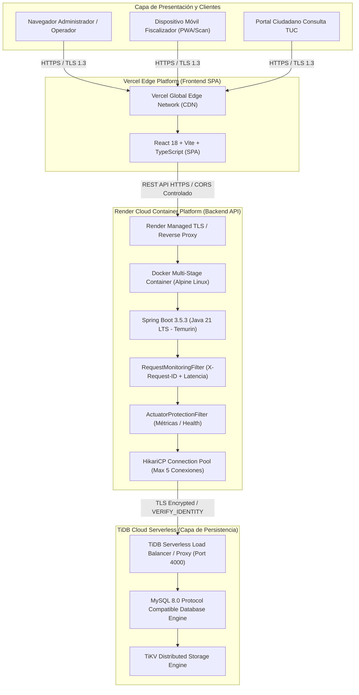

# Plan de Despliegue en Producción (Semana 15)
## Sistema de Gestión y Fiscalización de Transporte Urbano - MTC Municipalidad Distrital de Marcona

---

## 1. Arquitectura de Despliegue en Tres Capas

El sistema adopta una arquitectura desacoplada, resiliente y de alta disponibilidad, distribuida en plataformas cloud especializadas para optimizar costos y maximizar el rendimiento.



---

## 2. Ciclo de Vida de Compilación y Empaquetado Java (Apache Maven)

El empaquetado del backend se rige bajo el estándar de Apache Maven 3.9 sobre Eclipse Temurin JDK 21:

1. **`clean`**: Purga de artefactos compilados previos en `target/`.
2. **`test`**: Ejecución de la suite completa de pruebas unitarias y de integración (controladores `@WebMvcTest`, servicios de negocio y mantenimiento).
3. **`package`**: Compilación de clases a bytecode Java 21 y generación de reportes JaCoCo.
4. **`spring-boot:repackage`**: Empaquetado de un "Fat JAR" autónomo (`app.jar`) con dependencias embebidas y cargador de clases optimizado de Spring Boot.

### Proceso de Construcción en Contenedor (`backend/Dockerfile`)
Se emplea una estrategia multi-stage con imagen base Alpine para minimizar la superficie de ataque y el tamaño final (< 180 MB):

```dockerfile
# Etapa 1: Build con dependencias en caché
FROM maven:3.9.9-eclipse-temurin-21 AS build
WORKDIR /app
COPY pom.xml .
RUN mvn dependency:go-offline -B --no-transfer-progress
COPY src ./src
RUN mvn clean package -DskipTests -B --no-transfer-progress

# Etapa 2: Runtime seguro no-root
FROM eclipse-temurin:21-jre-alpine
WORKDIR /app
RUN addgroup -S spring && adduser -S spring -G spring && \
    mkdir -p /app/logs /app/uploads /tmp/mtc-logs && \
    chown -R spring:spring /app /tmp/mtc-logs
COPY --from=build --chown=spring:spring /app/target/*.jar app.jar
USER spring:spring
ENV PORT=8080
ENV LOG_PATH=/tmp/mtc-logs
EXPOSE 8080
ENTRYPOINT ["java", "-XX:+UseContainerSupport", "-XX:MaxRAMPercentage=75.0", "-Djava.security.egd=file:/dev/./urandom", "-jar", "app.jar"]
```

---

## 3. Tuning de Servidores e Infraestructura

### 3.1 Sizing y Tuning JVM en Render (512 MB RAM)
- **`-XX:+UseContainerSupport`**: Reconocimiento dinámico de las restricciones de cgroups del contenedor.
- **`-XX:MaxRAMPercentage=75.0`**: Asigna como máximo el 75 % de la memoria física (aprox. 384 MB de Heap) a la JVM, dejando un margen prudente de 128 MB para Metaspace, threads nativos y buffers del kernel, evitando el temido `OOMKilled` (Exit Code 137).
- **`-Djava.security.egd=file:/dev/./urandom`**: Generación rápida de entropía criptográfica no bloqueante para tokens JWT y TLS.

### 3.2 Optimización de HikariCP para TiDB Cloud Serverless
Dado que TiDB Cloud Serverless factura por Unidades de Solicitud (RUs) y Render impone límites de memoria:
- `maximum-pool-size=5`: Evita saturación de sockets y consumo excesivo de memoria en reposo.
- `minimum-idle=1`: Mantiene al menos un canal caliente para respuestas inmediatas.
- `idle-timeout=300000` (5 min): Libera conexiones inactivas.
- `max-lifetime=600000` (10 min): Renueva conexiones periódicamente antes de que los balanceadores de red de la nube las cierren por inactividad.

### 3.3 Política de CORS y Encabezados
- Orígenes permitidos: Dominios de producción en Vercel (`https://*.vercel.app`, `https://prueba2-blush.vercel.app`) y localhost para desarrollo.
- Cabecera expuesta: `X-Request-ID` para correlacionar desde la consola del navegador hacia los logs del servidor.

---

## 4. Matriz de Variables de Entorno Sanitizada

> [!IMPORTANT]
> **REGLA DE SEGURIDAD ABSOLUTA:** Jamás almacene contraseñas ni tokens en el repositorio Git. Ingréselos únicamente en los paneles de administración de cada plataforma.

### 4.1 Backend (Render Dashboard -> Environment)

| Variable de Entorno | Propósito | Valor de Ejemplo / Placeholder |
| :--- | :--- | :--- |
| `SPRING_DATASOURCE_URL` | JDBC URL hacia TiDB Cloud con SSL | `jdbc:mysql://<GATEWAY_HOST_TIDB>:4000/marcona_permisos?useSSL=true&sslMode=VERIFY_IDENTITY&serverTimezone=America/Lima` |
| `SPRING_DATASOURCE_USERNAME` | Usuario emitido por TiDB Cloud | `<USUARIO_TIDB_CLOUD>` |
| `SPRING_DATASOURCE_PASSWORD` | Contraseña emitida por TiDB Cloud | `<CONTRASENA_TIDB_CLOUD>` |
| `JWT_SECRET` | Clave secreta para firma criptográfica HMAC-SHA256 | `<CLAVE_SECRETA_JWT_MINIMO_64_CHARS>` |
| `JWT_EXPIRY` | Duración del token de sesión en segundos | `86400` (24 horas) |
| `APP_ENV` | Identificador de entorno de ejecución | `production` |
| `PORT` | Puerto asignado dinámicamente por Render | `8080` (inyectado automáticamente) |
| `CORS_ALLOWED_ORIGINS` | Dominios adicionales autorizados | `https://prueba2-blush.vercel.app` |
| `MONITORING_SCRAPE_TOKEN` | Token para scrapers externos de métricas | `<TOKEN_ALEATORIO_METRICAS_OPCIONAL>` |
| `LOG_PATH` | Ruta escribible para logs rotativos en Alpine | `/tmp/mtc-logs` |

### 4.2 Frontend (Vercel Project Settings -> Environment Variables)

| Variable de Entorno | Propósito | Valor de Ejemplo / Placeholder |
| :--- | :--- | :--- |
| `VITE_API_URL` | URL base de la API backend en Render | `https://transigovai-backend.onrender.com/api` |

---

## 5. Procedimiento de Verificación Post-Despliegue (Smoke Test)

Tras cada despliegue, el operador ejecuta el script automatizado:

```bash
# Ejecución local o remota
./infraestructura/scripts/smoke-test.sh \
  "https://transigovai-backend.onrender.com" \
  "https://prueba2-blush.vercel.app"
```

El script comprueba tres condiciones de salud críticas:
1. `GET /actuator/health` responde HTTP 200 con `{"status":"UP"}` y base de datos activa.
2. La cabecera `X-Request-ID` está presente en la respuesta HTTP.
3. El frontend en Vercel entrega el HTML principal con código HTTP 200.

---

## 6. Procedimiento de Rollback Inmediato

En caso de contingencia o fallo crítico detectado en producción:

### 6.1 Rollback en Frontend (Vercel)
1. Ingresar al panel del proyecto en Vercel -> pestaña **Deployments**.
2. Ubicar el último despliegue estable (Instant Snapshot anterior).
3. Hacer clic en los tres puntos `...` y seleccionar **Promote to Production**. El tráfico se redirige de inmediato (< 5 segundos).

### 6.2 Rollback en Backend (Render)
1. Ingresar al Dashboard de Render -> servicio **transigovai-backend**.
2. En la pestaña **Events**, ubicar el commit o compilación previa que funcionaba correctamente.
3. Seleccionar **Rollback to this deploy**. Render levantará la imagen previa sin recompilar código.

### 6.3 Rollback en Base de Datos (TiDB Cloud)
Si un cambio de esquema dañó datos, utilizar el script de restauración oficial con el último respaldo generado:

```bash
export DB_HOST="<GATEWAY_HOST_TIDB>"
export DB_PORT="4000"
export DB_NAME="marcona_permisos"
export DB_USER="<USUARIO_TIDB_CLOUD>"
export DB_PASSWORD="<CONTRASENA_TIDB_CLOUD>"

./infraestructura/scripts/RESTORE_BD.sh backups/marcona_permisos_20261119_020000.sql.gz
```
