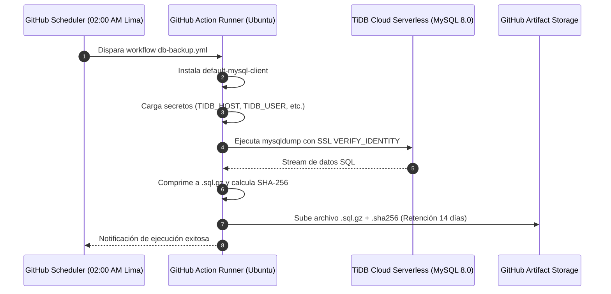

# Plan Maestro de Mantenimiento y Recuperación ante Desastres (Semana 17)
## Sistema de Gestión y Fiscalización de Transporte Urbano - MTC Municipalidad Distrital de Marcona

---

## 1. Los Cuatro Tipos de Mantenimiento de Software

El plan de soporte técnico y ciclo de vida del software se estructura conforme a las cuatro tipologías estándar de la ingeniería de software:

```mermaid
graph TD
    subgraph TiposMantenimiento ["Gestión del Ciclo de Vida del Software"]
        MP["1. Mantenimiento Preventivo"]
        MC["2. Mantenimiento Correctivo"]
        MA["3. Mantenimiento Adaptativo"]
        MPERF["4. Mantenimiento Perfectivo"]
    end

    MP --> MP1["Cron Jobs: Expiración de TUC y Purga de Rate Limits"]
    MP --> MP2["Verificación diaria de vencimientos (SOAT/CITV/Licencias)"]
    MP --> MP3["Respaldos diarios con verificación SHA-256"]

    MC --> MC1["Depuración de errores mediante Correlation-ID (X-Request-ID)"]
    MC --> MC2["Corrección de inconsistencias en padrón y auditoría"]
    MC --> MC3["Rollback inmediato en Vercel y Render ante fallas"]

    MA --> MA1["Compatibilidad con actualizaciones de TiDB Cloud / MySQL"]
    MA --> MA2["Adaptación a normativas distritales de transporte e inspección"]
    MA --> MA3["Soporte a navegadores móviles para fiscalizadores"]

    MPERF --> MPERF1["Optimización del pool HikariCP para menor consumo de RUs"]
    MPERF --> MPERF2["Streaming en exportación Excel con Apache POI"]
    MPERF --> MPERF3["Caché de consultas públicas y UI reactiva en Tailwind"]
```

---

## 2. Calendario de Tareas Programadas (Suite de Cron Jobs)

El sistema ejecuta tres tareas automáticas implementadas en `PermisoScheduler.java` y administradas mediante `MaintenanceServiceImpl.java`. Todas se configuran en la zona horaria oficial del Perú (`America/Lima`, UTC-5):

| ID del Job | Horario (Lima) | Expresión Cron | Propósito Técnico y Operativo | Impacto en BD / Rendimiento |
| :--- | :--- | :--- | :--- | :--- |
| **`EXPIRE_PERMITS`** | 00:05:00 diario | `0 5 0 * * *` | Revisa permisos TUC en estado `vigente` cuya `fecha_vencimiento < CURDATE()`, cambia su estado a `vencido` y registra la auditoría correspondiente. | Actualización transaccional mediante `FOR UPDATE` acotada a registros vencidos. Solo audita si hay registros afectados. |
| **`CLEANUP_RATE_LIMITS`** | 02:30:00 diario | `0 30 2 * * *` | Elimina registros de la tabla `rate_limits` con antigüedad superior a 24 horas (`created_at < DATE_SUB(NOW(), INTERVAL 24 HOUR)`). | Mantiene la base de datos ligera, previniendo consumo innecesario de almacenamiento en TiDB Cloud. |
| **`CHECK_UPCOMING_EXPIRATIONS`** | 07:00:00 diario | `0 0 7 * * *` | Totaliza documentos próximos a vencer en los siguientes 15 días: Permisos TUC, SOAT (`soat_vencimiento`), CITV (`rt_vencimiento`) y Licencias (`fecha_vencimiento_licencia`). | Consulta de solo lectura que emite logs estructurados de alerta `[ALERTA_VENCIMIENTOS]` y alimenta el panel de control. |

### Disparo Manual en Vivo para el Administrador
Cualquiera de los tres trabajos puede ejecutarse a demanda desde la pantalla `/monitoreo` -> pestaña **3. Mantenimiento y Cron Jobs**, mediante el botón **"Ejecutar ahora"** (`POST /api/monitoring/jobs/{jobId}/run`). Esta acción queda registrada en la bitácora de auditoría forense con el usuario del Administrador actuante.

---

## 3. Política de Respaldo y Recuperación ante Desastres (DRP)

### 3.1 Objetivos de Recuperación
- **RPO (Recovery Point Objective):** $\le 24\text{ horas}$ (garantizado por el respaldo diario nocturno automatizado).
- **RTO (Recovery Time Objective):** $\le 30\text{ minutos}$ (tiempo máximo para restaurar el dump comprimido y verificar integridad).

### 3.2 Estrategia 3-2-1 Adaptada a la Nube
1. **3 Copias de los Datos:**
   - Base de datos en producción (TiDB Cloud Serverless con replicación interna multi-zona mediante motor distribuido TiKV).
   - Respaldos diarios comprimidos en `.sql.gz` custodiados como artefactos de GitHub Actions.
   - Copia secundaria local o en almacenamiento de contingencia del administrador.
2. **2 Medios / Formatos Diferentes:**
   - TiKV storage distribuido en línea.
   - Archivos SQL planos comprimidos con gzip y sumas de verificación criptográfica SHA-256.
3. **1 Copia Fuera de Sitio (Off-site):**
   - Artefactos aislados fuera del proveedor de base de datos (almacenados en la infraestructura global de GitHub / AWS S3).

---

## 4. Catálogo de Scripts Operativos y de Mantenimiento

Todos los scripts se ubican en `infraestructura/scripts/` y cuentan con permisos de ejecución:

| Script | Función Principal | Parámetros / Variables |
| :--- | :--- | :--- |
| **`BACKUP_TIDB_CLOUD.sh`** | Genera un dump completo compatible con TiDB Cloud (`--ssl-mode=VERIFY_IDENTITY`, sin GTID, con routines y triggers), lo comprime en `.sql.gz`, crea el archivo `.sha256` y purga copias de más de 14 días. | `DB_HOST`, `DB_PORT`, `DB_NAME`, `DB_USER`, `DB_PASSWORD`, `BACKUP_DIR` |
| **`RESTORE_BD.sh`** | Valida la suma hash `.sha256`, descomprime y restaura la base de datos solicitando confirmación explícita (o bypass `--force`). | `$1`: Ruta al archivo `.sql.gz`, `$2`: `--force` (opcional) |
| **`smoke-test.sh`** | Valida de extremo a extremo que el backend (`/actuator/health`), los headers (`X-Request-ID`) y el frontend respondan exitosamente (HTTP 200). | `$1`: URL Backend, `$2`: URL Frontend |

---

## 5. Automatización con GitHub Actions (`.github/workflows/db-backup.yml`)

El respaldo de la base de datos se ejecuta sin intervención humana cada madrugada a las **02:00 AM hora de Lima** (07:00 UTC):

---

## 6. Lista de Endurecimiento Continuo (Hardening y Mejoras Futuras)

Para las siguientes fases evolutivas del sistema, se recomienda implementar:

1. **Rotación Periódica de Credenciales:**
   - Programar la rotación trimestral de la clave secreta `JWT_SECRET` y de las contraseñas de TiDB Cloud en los paneles de Render y GitHub Secrets.
2. **Migración de Archivos Adjuntos a Object Storage:**
   - Migrar el almacenamiento local de `uploads/` (imágenes de vehículos y conductores) hacia un bucket compatible con S3 (ej. Cloudflare R2 o AWS S3) para evitar pérdida de datos en contenedores efímeros.
3. **Modo Offline PWA para Fiscalizadores en Vía Pública:**
   - Implementar IndexedDB y Service Workers en el frontend para permitir a los inspectores escanear códigos QR y validar TUCs en zonas del distrito de Marcona con baja cobertura móvil, sincronizando la bitácora cuando se recupere la señal.
4. **Rate Limiting Distribuido con Redis:**
   - Migrar la tabla `rate_limits` a un clúster Upstash Redis Serverless en caso de que el tráfico de consultas públicas supere las 1,000 peticiones por minuto.
