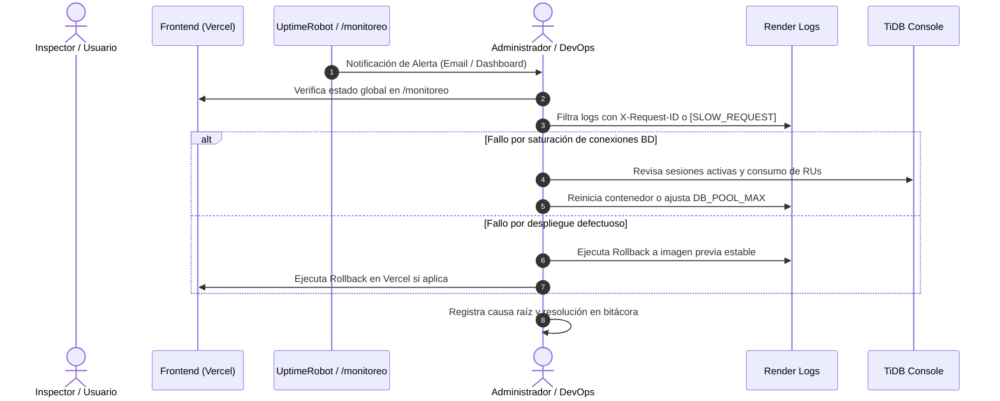

# Plan Integral de Monitoreo y Observabilidad (Semana 16)
## Sistema de Gestión y Fiscalización de Transporte Urbano - MTC Municipalidad Distrital de Marcona

---

## 1. Estrategia Integral en Tres Pilares

La observabilidad del sistema se fundamenta en tres pilares complementarios para garantizar detección temprana de fallos, diagnóstico ágil y trazabilidad forense:

```mermaid
graph TD
    subgraph Observabilidad ["Ecosistema de Monitoreo MTC Marcona"]
        P1["Pilar 1: Trazabilidad y Logs"]
        P2["Pilar 2: Performance Tools"]
        P3["Pilar 3: OS Health & Infraestructura"]
    end

    subgraph ComponentesP1 ["Componentes Pilar 1"]
        Logback["logback-spring.xml (Consola + Archivo Rotativo)"]
        ReqId["RequestMonitoringFilter (X-Request-ID / MDC)"]
        AuditLog["Tabla action_logs (Auditoría Forense Funcional)"]
    end

    subgraph ComponentesP2 ["Componentes Pilar 2"]
        Micrometer["Micrometer Prometheus Registry (/actuator/prometheus)"]
        DashboardAdmin["Panel /monitoreo (KPIs HTTP y Eventos Lentos)"]
        K6["Pruebas de Carga k6 (SLA p95 < 800ms)"]
        TiDBMetrics["TiDB Cloud Metrics (Monitoreo de RUs y QPS)"]
    end

    subgraph ComponentesP3 ["Componentes Pilar 3"]
        Actuator["Spring Boot Actuator (/actuator/health)"]
        Hikari["HikariPoolMXBean (Conexiones y Latencia BD)"]
        LocalStack["docker-compose.monitoring.yml (Prometheus, Grafana, cAdvisor)"]
        UptimeRobot["UptimeRobot Externo (Monitor HTTP 24/7)"]
    end

    P1 --> Logback
    P1 --> ReqId
    P1 --> AuditLog

    P2 --> Micrometer
    P2 --> DashboardAdmin
    P2 --> K6
    P2 --> TiDBMetrics

    P3 --> Actuator
    P3 --> Hikari
    P3 --> LocalStack
    P3 --> UptimeRobot
```



---

## 2. Detalle de los Tres Pilares

### Pilar 1: Logs Estructurados y Trazabilidad HTTP
1. **Correlation-ID (`X-Request-ID`):**
   - El filtro `RequestMonitoringFilter` inyecta un identificador único en el `MDC` (`requestId`) por cada petición HTTP.
   - Si el cliente envía una cabecera `X-Request-ID`, esta se preserva; si no, se genera un identificador compacto de 10 caracteres alfanuméricos.
   - La cabecera se retorna en la respuesta HTTP para que el frontend o el usuario puedan reportar fallas referenciando dicho ID exacto.
2. **Patrón de Logs (`logback-spring.xml`):**
   - Salida a consola y archivo rotativo (`/tmp/mtc-logs/mtc-backend.log`):
     ```
     %d{yyyy-MM-dd HH:mm:ss.SSS} %-5level [reqId=%X{requestId:-SYSTEM}] [%thread] %logger{36} - %msg%n
     ```
   - Política de rotación: Diaria con corte a 10 MB por fragmento, compresión automática en `.gz`, retención de 14 días y límite máximo total de 100 MB en disco.
3. **Separación de Responsabilidades:**
   - **Logs Técnicos (STDOUT / Archivo):** Errores de red, fallas de conexión SQL, latencias de endpoints, avisos de solicitudes lentas `[SLOW_REQUEST]`.
   - **Bitácora Funcional (`action_logs` en BD):** Acciones humanas y del negocio (creación de permisos, revocación de licencias, auditoría de accesos y ejecuciones manuales de mantenimiento).

### Pilar 2: Herramientas de Rendimiento (Performance Tools)
1. **Micrometer + Prometheus:**
   - Exposición estándar en `/actuator/prometheus` protegida mediante `ActuatorProtectionFilter` (solo accesible por red interna o con token de scraping `MONITORING_SCRAPE_TOKEN`).
2. **Panel de Monitoreo (`/monitoreo`):**
   - Interfaz web exclusiva para el Administrador que consolida métricas sin impacto en base de datos gracias al buffer circular en memoria `RequestMetricsRegistry`:
     - Tasa de éxito (`2xx`), tasa de errores de cliente (`4xx`) y de servidor (`5xx`).
     - Latencia promedio y máxima acumulada.
     - Registro de peticiones lentas (`>= 500 ms`) con hora, método y Correlation-ID.
3. **Pruebas de Carga k6 (`infraestructura/k6/load-test.js`):**
   - Evalúa el comportamiento bajo estrés simulando perfiles `local` (20 VUs) y `cloud` (5 VUs) respetando los límites de TiDB Cloud Serverless y Render Free Tier.
4. **Métricas Nativas de TiDB Cloud:**
   - Monitoreo de consumo de Request Units (RUs), distribución de operaciones de lectura/escritura y optimización de índices lentos desde la consola de TiDB Cloud.

### Pilar 3: Salud del Sistema Operativo e Infraestructura (OS Health)
1. **Spring Boot Actuator Health Check:**
   - Endpoint `/actuator/health` configurado como sonda de liveness/readiness para Render y UptimeRobot.
   - Verifica conectividad de base de datos (`SELECT 1`).
2. **Métricas de Hardware y JVM:**
   - Lectura vía JMX (`OperatingSystemMXBean` y `Runtime`): Carga de CPU (sistema vs proceso), uso de Heap JVM frente al límite de 512 MB de Render, espacio libre en disco y tiempo de actividad (*Uptime*).
3. **Telemetría del Pool HikariCP:**
   - Estado de conexiones activas, inactivas, tamaño máximo del pool y cantidad de hilos en cola de espera (`threadsAwaitingConnection`).
4. **Stack Local de Observabilidad:**
   - Configurado en `infraestructura/docker-compose.monitoring.yml` (Prometheus en puerto `9090`, Grafana en `3001` y cAdvisor en `8085` para métricas de contenedores Docker).
5. **Vigilancia Externa con UptimeRobot:**
   - Monitoreo HTTP sintético cada 5 minutos apuntando a `https://transigovai-backend.onrender.com/actuator/health` con alerta inmediata por correo ante caídas.

---

## 3. Matriz de KPIs, SLI / SLO y Semáforo de Alertas

| Indicador (KPI) | SLI (Métrica Medida) | SLO (Objetivo de Nivel de Servicio) | Verde (Normal) | Ámbar (Alerta) | Rojo (Crítico) |
| :--- | :--- | :--- | :--- | :--- | :--- |
| **Disponibilidad API** | Peticiones HTTP 2xx/3xx sobre total | $\ge 99.5\%$ de disponibilidad mensual | $\ge 99.5\%$ | $95.0\% - 99.4\%$ | $< 95.0\%$ |
| **Latencia p95 (API)** | Tiempo de respuesta del percentil 95 | $\le 800\text{ ms}$ en endpoints transaccionales | $< 500\text{ ms}$ | $500 - 800\text{ ms}$ | $> 800\text{ ms}$ |
| **Tasa de Errores 5xx** | Peticiones con código HTTP 5xx | $< 1.0\%$ del total de peticiones | $< 0.5\%$ | $0.5\% - 1.0\%$ | $> 1.0\%$ |
| **Uso de Memoria JVM** | Memoria Heap usada vs Max Heap (384MB) | $\le 80\%$ de la memoria disponible | $< 70\%$ | $70\% - 85\%$ | $> 85\%$ (Riesgo OOM) |
| **Uso de CPU Host** | Carga de CPU del contenedor | $\le 75\%$ promedio en periodos de 5 min | $< 60\%$ | $60\% - 85\%$ | $> 85\%$ |
| **Saturación HikariCP** | Hilos esperando conexión (`threadsAwaiting`) | $0$ hilos esperando en régimen normal | $0$ | $1 - 2$ hilos | $\ge 3$ hilos |
| **Latencia BD (Ping)** | Tiempo de ejecución de `SELECT 1` | $\le 50\text{ ms}$ hacia TiDB Cloud | $< 35\text{ ms}$ | $35 - 80\text{ ms}$ | $> 80\text{ ms}$ |

---

## 4. Protocolo de Respuesta ante Incidentes y Matriz de Escalamiento

### 4.1 Niveles de Severidad

- **SEV-1 (Crítico):** Servicio backend inaccesible (`DOWN`), base de datos inaccesible, o tasa de error 5xx $> 5\%$.
- **SEV-2 (Mayor):** Latencia p95 $> 1500\text{ ms}$, saturación persistente de memoria JVM ($> 85\%$) o fallas en emisión de TUC.
- **SEV-3 (Menor):** Fallo en la ejecución de un Cron Job diario o alertas preventivas de saturación de disco temporal.

### 4.2 Flujo de Atención de Incidentes



### 4.3 Matriz de Escalamiento

1. **Nivel 1 (Operador Municipal / Fiscalizador):** Detecta anomalía visual o error recurrente y reporta el `X-Request-ID` al Administrador.
2. **Nivel 2 (Administrador de Sistemas Marcona):** Accede a `/monitoreo`, revisa la salud del SO/BD y ejecuta manualmente tareas correctivas si aplica.
3. **Nivel 3 (Arquitecto / Ingeniero DevOps):** Analiza logs en Render, ajusta configuraciones de memoria, ejecuta scripts de recuperación o escala parámetros en TiDB Cloud.
